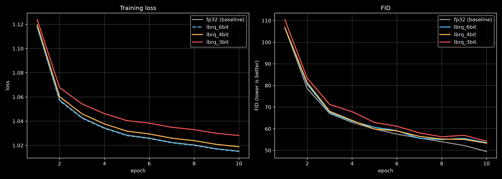

# VaeZip Train Benchmark

This is the benchmark that explores how lossy compression of low-bit codecs from [VaeZip](https://github.com/tensorforger/VaeZip) impact training process.


## What is trained and measured

The same small text-to-image diffusion transformer is trained from scratch four times. The only thing that changes between runs is how the training latents were stored on disk:

| Run | Latent storage | Bits per value | Latent size vs `fp32` |
|---|---|---:|---:|
| `fp32` | uncompressed baseline | 32 | 1.0x |
| `lbrq_6bit` | VaeZip `lbrq_6bit` | ~6.1 | ~5x smaller |
| `lbrq_4bit` | VaeZip `lbrq_4bit` | ~4.1 | ~8x smaller |
| `lbrq_3bit` | VaeZip `lbrq_3bit` | ~3.1 | ~10x smaller |

`lbrq` is block-wise min/max quantization with Lloyd-Max level tables, the best scheme of the previous [LatentStorageBenchmark](https://github.com/tensorforger/LatentStorageBenchmark). That benchmark measured how much *reconstruction* quality is lost by such storage; this one measures what it does to *training*.

Setup:

- **Data:** COCO 2017 train (118k images), center-cropped to 256x256, first caption of every image.
- **Latents:** FLUX.2 VAE (32 channels, 8x downsampling, so 32x32x32 per image), decoded back to fp32 by the data loader on the fly. Text embeddings (SDXL text encoder) are identical fp32 in all runs.
- **Model and objective:** a 16-block transformer (width 512) trained with flow matching (velocity prediction, logit-normal timesteps), 10 epochs, EMA weights used for sampling.
- **Fairness:** all runs share the seed, model init, data order, noise and timesteps, so the differences come from the stored latents only.
- **Metrics:** mean training loss per epoch, and FID after every epoch. For FID, 2048 images are generated from COCO val2017 captions (32 Euler steps, fixed seeds) and compared against COCO train2017 statistics at 256x256. Generated samples of every epoch are saved to `samples/`.

## Results



| Run | Final train loss | Final FID | Epoch time |
|---|---:|---:|---:|
| `fp32` | 1.0152 | 49.5 | ~8.3 min |
| `lbrq_6bit` | 1.0150 | 53.6 | ~8.3 min |
| `lbrq_4bit` | 1.0189 | 53.3 | ~8.2 min |
| `lbrq_3bit` | 1.0281 | 54.2 | ~8.2 min |

## Analysis

**Training loss follows the quantization level.** The curves are ordered `fp32` = `lbrq_6bit` < `lbrq_4bit` < `lbrq_3bit` from the first epoch to the last, and the gap does not close with more training. `lbrq_6bit` is indistinguishable from the baseline, `lbrq_4bit` is slightly above, and `lbrq_3bit` is clearly above.

**Why the loss grows as quantization gets more extreme.** Quantization replaces every latent `x` with `x + e`, where `e` is a small, essentially random error that depends on the patch contents and cannot be predicted from the text prompt or the noisy input. The model is trained to predict a velocity that contains this `e`, so a part of the target is pure noise to it and sets a floor under the loss that no amount of training removes. The error power rises about 4x for every bit removed, which matches the observed picture: nothing visible at 6 bits, a small step at 4 bits, and a roughly 3x larger step at 3 bits. The loss gap is therefore not a sign of a worse optimization, it is the quantization noise showing up in the measured target. Note that the loss is computed against the stored (quantized) latents, so it is a diagnostic of how noisy the data is rather than a direct quality metric.

**FID.** All runs are still improving after 10 epochs, and the low-bit runs follow the same trajectory as the baseline with a small offset at the end. The FID differences between `lbrq_6bit`, `lbrq_4bit` and `lbrq_3bit` are of the same size as the epoch-to-epoch jitter of a single run (2048 generated images, one seed), so FID does not separate them reliably. The training loss, which is averaged over a whole epoch, is the more sensitive signal here. All compressed runs end a few FID points above `fp32`, but with this setup that cannot be attributed to a specific bit width.

**Throughput.** Epoch time is the same for all runs. Decoding the codecs in the data loader workers is not a bottleneck, while the dataset latents take 5-10x less space.

**Consistency with the previous benchmark.** The ordering matches the reconstruction results of [LatentStorageBenchmark](https://github.com/tensorforger/LatentStorageBenchmark): around 6 bits the VAE roundtrip is practically lossless, around 4 bits it costs a fraction of a dB PSNR, and quality drops quickly below that (~0.25 dB at 4.5 bits and ~0.9 dB at 3.5 bits on FLUX.2 for the Lloyd-Max scheme with 4x4 blocks). The `lbrq_*` shortcuts used here use 8x8 blocks and about 0.4 bits per value less, so the numbers are indicative only.

## Usage recommendations

| Codec | Use for | Comment |
|---|---|---|
| `lbrq_6bit` | Training | Safe default. Loss matches `fp32`, about 5x smaller latents. |
| `lbrq_4bit` | Training with caution | On the edge: a small but consistent loss penalty, about 8x smaller. Fine for large-scale pretraining where storage dominates, validate on your own data and model first. |
| `lbrq_3bit` | Inference and transfer | Clearly the noisiest targets (loss gap about 3x of `lbrq_4bit`). Prefer it for storing or sending latents that are decoded or lightly processed, not as a training target. |

General rules:

- If the budget allows, `lbrq_6bit` costs nothing measurable; going lower buys storage at the price of a floor on the loss.
- Store the text embeddings in higher precision than the image latents, here they were kept in fp32 and are a large part of the dataset on disk.
- The effect is expected to be larger for VAEs with fewer latent channels (e.g. SDXL), see the previous benchmark.

## Limitations

- One model size, one dataset, 10 epochs from scratch, a single seed per run. Longer training, larger models or fine-tuning may behave differently.
- FID on 2048 samples is noisy and the numbers are not comparable with published COCO results.
- Only the FLUX.2 VAE was used.


## Reproduction setup

### Environment

```bash
uv venv --python=3.12
source .venv/bin/activate
# adjust the index URL to your CUDA version
uv pip install --pre torch torchvision torchaudio --index-url https://download.pytorch.org/whl/nightly/cu134
uv pip install -r requirements.txt
uv pip install -e .
```

### Models

Only the VAE weights and the SDXL text encoder and tokenizer are needed.

```bash
cd models

hf download black-forest-labs/FLUX.2-klein-4B --include "vae/*" --local-dir FLUX.2-klein-4B
hf download stabilityai/stable-diffusion-xl-base-1.0 --include "text_encoder/*" --include "tokenizer/*" --local-dir stable-diffusion-xl-base-1.0
```

### Datasets

```bash
cd datasets

hf download --local-dir coco-2017 pcuenq/coco-2017-mirror --repo-type dataset
unzip coco-2017/annotations_trainval2017.zip -d coco-2017/
unzip coco-2017/train2017.zip -d coco-2017/
```

This saves `train2017/` and `annotations/` to `datasets/coco-2017`.

## Usage

```bash
# one-time: encode COCO into fp32 and lbrq_{6,4,3}bit latent datasets (text embeddings included)
python scripts/encode_dataset.py

# train one model per latent storage; logs go to runs/, samples to samples/
python scripts/train.py --dataset-source fp32
python scripts/train.py --dataset-source lbrq_6bit
python scripts/train.py --dataset-source lbrq_4bit
python scripts/train.py --dataset-source lbrq_3bit

# make results.png from runs/
python scripts/plot_results.py
```

The FID reference statistics are computed on the first run and cached in `datasets/coco-2017/`.


## License

See [LICENSE](LICENSE). Datasets and model weights are subject to their own licenses.
